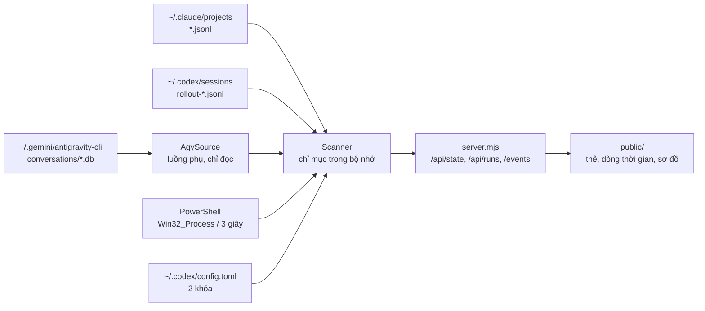

# Kiến trúc

## Luồng dữ liệu

Mọi nguồn chỉ đọc. Chỉ mục nằm trong bộ nhớ; khởi động lại thì quét lại. `bin/agent-board.mjs` chỉ điều khiển tiến trình (chạy nền, dừng, trạng thái), không đọc dữ liệu.

## Thành phần

| Tệp | Vai trò |
| --- | --- |
| `server.mjs` | HTTP chỉ GET, SSE, phục vụ `public/`, kiểm `Host`, bắt lỗi mức tiến trình để một nguồn lỗi không làm chết bảng |
| `lib/scanner.mjs` | điều phối quét: khám phá tệp, đọc phần nối thêm, dựng danh sách run, phát sự kiện `change` |
| `lib/scan-workers.mjs`, `lib/scanner-worker.mjs` | nhóm tối đa 4 luồng phụ chỉ dùng cho lượt quét đầu lớn; mỗi tệp vẫn được xử lý tuần tự |
| `lib/parsers.mjs` | phân tích lệnh giao việc, che bí mật, ghép Codex, quy tắc phân làn model, lời nhắc |
| `lib/agy.mjs` | đọc SQLite của agy (chỉ đọc, luồng riêng), giải mã trường protobuf (mốc giờ, lời nhắc, thư mục, token), ghép với lệnh Claude |
| `lib/tokens.mjs` | chuẩn hóa và cộng dồn token cho Claude, Codex, agy; tính `tokens24h`, `busyMs24h`, `tokensRunning` |
| `lib/projects.mjs` | xác định dự án theo thư mục project của Claude, dự án ngoài Claude, giao chéo, lý do "không rõ" |
| `lib/prompt-files.mjs` | đọc dòng đầu của tệp lời nhắc theo danh sách cho phép |
| `lib/processes.mjs` | quét tiến trình `agy`, `codex` đang chạy |
| `lib/codex-config.mjs` | đọc đúng hai khóa `model` và `model_reasoning_effort` |
| `public/` | giao diện thuần (`app.js`, `mindmap.js`, `mindmap-layout.js`, `counters.js`, `wake-lock.js`, `model-labels.js`, `activity.js`, `styles.css`) |
| `bin/agent-board.mjs`, `bin/agent-board.cmd` | lệnh `start`, `stop`, `restart`, `status` |
| `scripts/` | công cụ phát triển: `fingerprint`, `perf`, `smoke`, `survey` (xem [KIEM-THU.md](KIEM-THU.md)) |

## Quét tăng dần

- Tệp JSONL được đọc theo luồng, nhớ offset byte, chỉ đọc phần nối thêm mỗi 5 giây; tệp mới được tìm mỗi 30 giây. Dòng chưa hoàn chỉnh được đọc lại ở lượt sau; dòng vượt 16 MiB bị bỏ qua kèm cảnh báo.
- Hội thoại agy kiểm tra dấu vân tay `.db` và `.db-wal` (kích thước, mtime) mỗi 5 giây; chỉ tệp đổi mới được phân tích lại. Các lần `refresh()` chồng nhau được gộp thành một.
- Tiến trình Windows lấy bằng PowerShell mỗi 3 giây, không bao giờ chạy hai lượt đồng thời.
- Trong lượt quét đầu, `rebuild()` (dựng lại danh sách run) chỉ chạy tối đa mỗi 5 giây vì đắt theo số run; tiến độ vẫn phát mỗi 400 ms. Công việc đồng bộ dài được cắt lát khoảng 15 ms và nhường vòng lặp.
- Tiền lọc rẻ trên chuỗi thô trước `JSON.parse`, che bí mật làm lười (chỉ che khi đưa ra đầu ra), chuẩn hóa chuỗi đường dẫn một lần cho mỗi run và chỉ mục ghép thay cho vòng lồng O(R×C).

## API

Chỉ có `GET`:

- `/api/state`: trạng thái năm làn (kèm `models24h`, `models7d`, `tokens24h`, `busyMs24h`, `tokensRunning`), tiến độ quét (kèm thống kê, gồm `crossProjects`), cấu hình Codex hiện tại.
- `/api/runs?from=ISO&to=ISO`: các lần giao việc và đoạn hoạt động trong khoảng; lời nhắc đã che; có `tokens`, `tokenSource`, cờ `crossProject` và các trường `workProject*` khi giao chéo dự án (chi tiết ở [NGUON-DU-LIEU.md](NGUON-DU-LIEU.md)).
- `/events`: SSE đẩy trạng thái mỗi khi đổi, nhịp tim mỗi 15 giây.

Mã làn nội bộ là `Claude`, `Codex`, `Opus`, `Argon`, `DeepSeek`; tên hiển thị ("Claude Code", "Antigravity Opus", "Gemini Argon", "DeepSeek") chỉ tồn tại ở giao diện (`public/model-labels.js`). Trạng thái "giao/làm" (`public/activity.js`) là dẫn xuất phía giao diện, không nằm trong dữ liệu quét.

## Bảo mật và quyền riêng tư

- Chỉ lắng nghe IPv4 loopback `127.0.0.1`. `Host` phải là `127.0.0.1:<cổng>` hoặc `localhost:<cổng>`, nếu không trả 403 (chống DNS rebinding). Không bật CORS. Đặt `Cache-Control: no-store`, `X-Content-Type-Options: nosniff` và CSP chặt (`default-src 'self'`).
- Dữ liệu từ bản ghi là không tin cậy: mọi chuỗi đưa vào DOM bằng `textContent`/`setAttribute`, không dùng `innerHTML`.
- Lời nhắc được che mẫu bí mật (chuỗi dài, `Bearer`, `sk-`, `token=`...) và cắt ngắn (200 ký tự ở chi tiết, 120 ở thẻ) trước khi giữ trong chỉ mục. Che mẫu là biện pháp đơn giản, không phải bộ phân loại bí mật hoàn chỉnh. Không ghi dòng lệnh tiến trình thô hay nội dung hội thoại ra đĩa hoặc nhật ký.
- Đường dẫn tệp lời nhắc lấy từ bản ghi nên chỉ đọc khi nằm dưới `<thư mục tạm>/claude` hoặc `~/.claude/projects`, không đi qua liên kết (kiểm từng thành phần đường dẫn, `O_NOFOLLOW`, khớp inode trước và sau khi mở), tối đa 1 MiB, đọc 8 KiB đầu.
- agy: mở SQLite bằng `new DatabaseSync(path, { readOnly: true })`. Không giải mã bằng khóa, không đọc keyring, không gọi daemon Antigravity, không dùng công cụ đọc agy bên ngoài. Chỉ chọn các cột cần thiết; payload chỉ chọn cho bước loại 14.
- Cấu hình Codex: chỉ đọc từng dòng để lấy hai khóa `model` và `model_reasoning_effort`; phần còn lại của tệp không được phân tích hay lưu.

## Hiệu năng (đo mẫu)

Trên máy phát triển, lượt quét đầu đọc khoảng 480 MB bản ghi trong khoảng 6 đến 9 giây khi máy rảnh; độ trễ vòng lặp sự kiện tối đa khoảng 60 đến 80 ms; lượt quét tăng dần khi không có tệp đổi dưới 50 ms; RSS cỡ 220 MiB. Con số phụ thuộc máy và khối lượng dữ liệu; cách đo ở [KIEM-THU.md](KIEM-THU.md).
